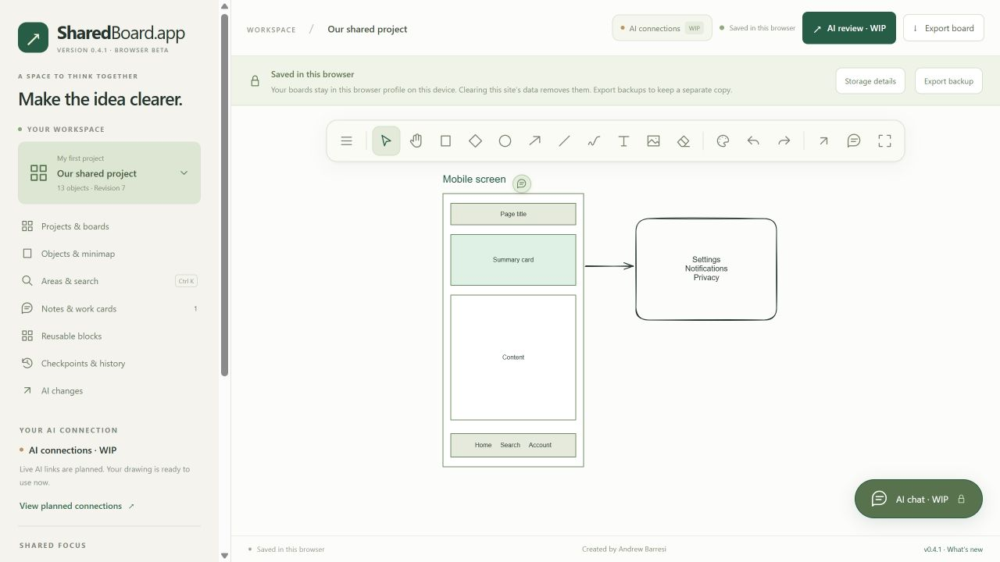
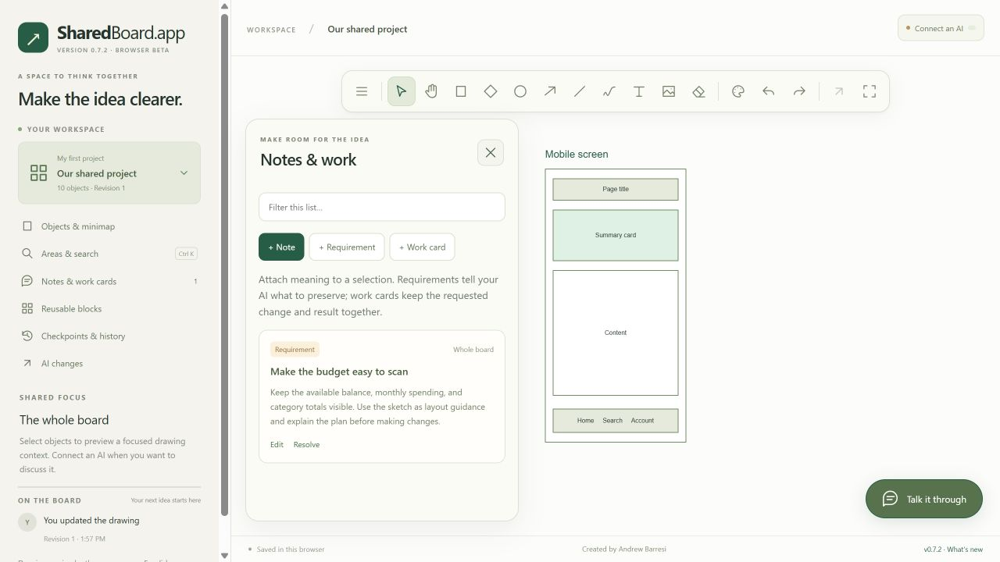

<div align="center">

# SharedBoard.app

### Turn sketches into a clearer plan for your next build.

A persistent whiteboard for app screens, architecture, references, and the context behind them.

**Browser beta · Open source · MIT**

[**Open SharedBoard.app ↗**](https://sharedboard.app) · [Source](https://github.com/AndBarresi/sharedboard-app) · [What's new](CHANGELOG.md)

Created by [**Andrew Barresi**](https://github.com/AndBarresi)

</div>

---



<p align="center"><sub>A shared place for screen sketches, references, and the details behind your plan.</sub></p>

## A canvas with context

Sketch a screen, map a system, pin a screenshot, and attach the requirements that explain what should happen next. SharedBoard.app builds on the open-source Excalidraw editor with a planning workspace around it.

| Make the plan | Keep it useful |
| --- | --- |
| **Draw freely** | Shapes, text, arrows, images, freehand drawing, and a canvas-only view. |
| **Organize your work** | Separate projects and boards, named areas, object search, a minimap, and confirmed deletion of work you no longer need. |
| **Explain the details** | Attached notes, requirements, work cards, and screenshot references. |
| **Reuse and recover** | Editable starting blocks, your own block library, checkpoints, and automatic recovery. |
| **Bring your existing AI** | Connect a compatible AI chat through SharedBoard’s hosted MCP relay, with read-only or requested-edit access. |

<details>
<summary><strong>Take a closer look at the planning workspace</strong></summary>



Keep requirements, named areas, and reusable building blocks beside the drawing they describe.

</details>

## Start on the website

1. Open [**sharedboard.app**](https://sharedboard.app) in a regular browser profile.
2. Draw something, add a reference or note, and wait for the saved indicator.
3. Use **Export board** to keep a `.sharedboard` backup outside the browser.

SharedBoard runs in the browser. There is no SharedBoard application or companion to install on Windows or Mac.

> **Your boards stay in your browser.** They are saved on this device in this browser profile, with no cross-device sync. Clearing site data or leaving private browsing can remove them. Export regularly; each backup contains one board's drawing and planning details. Another domain or preview address has separate storage.

## Connect the AI conversation you already use

Choose **Connect an AI**, select your app and its board access, then prepare the connection. SharedBoard provides a hosted MCP server URL to add in your AI app and pairing instructions to paste into the conversation you want to keep using. Follow [the connection guide](CONNECTIONS.md).

Your AI app must support remote MCP tools; availability depends on its capabilities and your plan. Selecting Codex, ChatGPT, Claude, or another client in SharedBoard does not enable tools that the client does not support.

Once connected, ask the assistant **in your existing AI conversation** to read the board, explain the current plan, or make a drawing change you request. Read-only access supports inspection and replies; drawing changes require requested-edit access. Keep the browser board open while it uses the tools.

**Automatic mini chat and Ask AI to look are still WIP.** They require a verified incoming-event subscription, and the committed deployment has no active, verified production callback route. Ordinary remote MCP tools alone do not wake an idle local Codex or Claude Code chat. Unsupported connections keep new board-originated sends unavailable rather than requiring you to copy each message.

A native Claude test on **2026-10-27** rendered the experimental MCP Apps panel, but its message call only filled Claude’s composer and still required the user to press Send. It did not start a model turn or return an automatic reply. The panel remains diagnostic WIP; successful rendering or a provider selection does not establish automatic chat support. See [connection behavior and the test boundary](BRIDGE.md).

Keep the board tab open while your AI reads or edits it. Saved requests retain their captured context, delivery and replies are separate states, and overlapping drawing edits remain visible for you to resolve. SharedBoard connects your existing model; it does not host another model or include an AI subscription. Context you share passes through the Cloudflare relay to the connected AI service.

Use **Projects & boards** to delete a board or project only after reviewing its confirmation. Project deletion includes every board it contains and revokes those boards’ connections. This permanently removes their local drawings, notes, saved messages, and recovery history. Export wanted backups first. Unrelated boards remain available, and deleting the final board creates a blank board to continue in.

## Build and contribute

Use the pinned Node version in [`.node-version`](.node-version) and pnpm **11.25.0** to work on the source:

```sh
pnpm install --frozen-lockfile
pnpm test
pnpm build:web
pnpm preview:web
```

These are developer commands; people using the app start at the website. See [Development](docs/LOCAL-DEVELOPMENT.md) for isolated previews and testing, and [Hosting](HOSTING.md) for the frontend and hosted relay deployment.

## Read more

[Connection setup](CONNECTIONS.md) · [Connection behavior](BRIDGE.md) · [Development](docs/LOCAL-DEVELOPMENT.md) · [Hosting](HOSTING.md) · [Changelog](CHANGELOG.md) · [Authorship & credits](AUTHORS.md) · [MIT license](LICENSE)

SharedBoard.app is a **0.x testing beta**. Live voice, multi-user cloud board storage, and automatic verification of generated code are not implemented. Client/account acceptance still needs real testing. The project uses the [Excalidraw editor](https://github.com/excalidraw/excalidraw); third-party components retain their own [notices and licenses](THIRD_PARTY_NOTICES.md).
